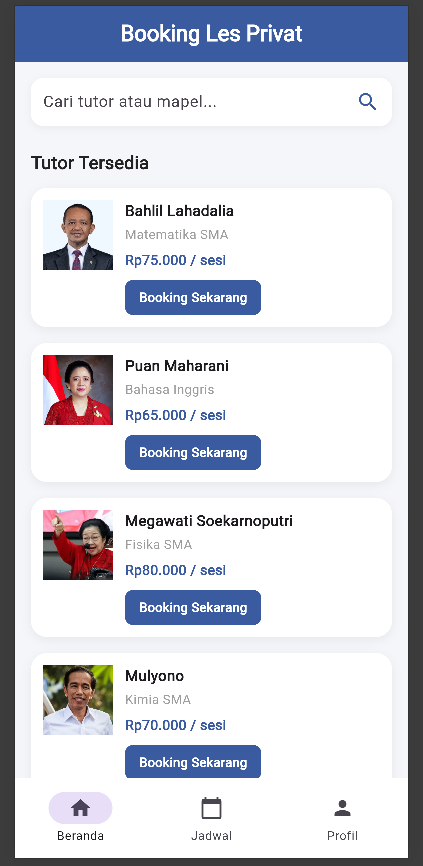
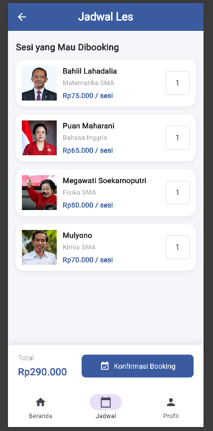
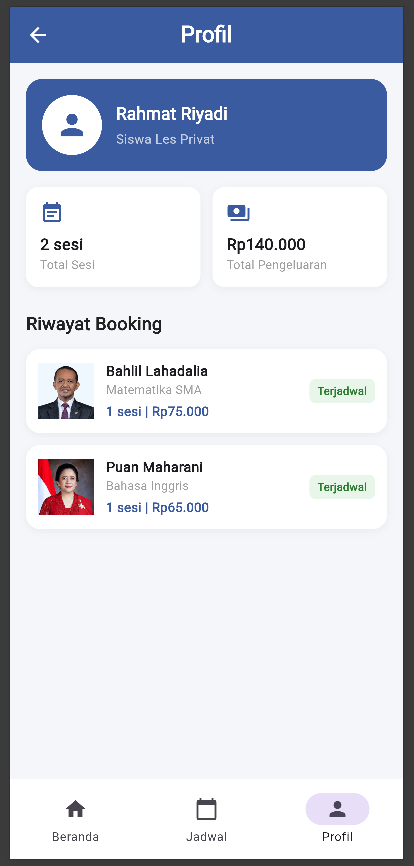

# Booking Les Privat

Aplikasi mobile berbasis Flutter untuk mencari dan memesan tutor les privat sesuai mata pelajaran yang dibutuhkan. Project ini dikembangkan secara bertahap sebagai tugas praktikum mata kuliah Pemrograman Piranti Bergerak, Program Studi Informatika, Universitas Mulawarman.

## Tampilan Aplikasi







## Progres Pengembangan

| Posttest   | Materi                         | Yang Dikerjakan                                                                 | Status  |
| ---------- | ------------------------------ | ------------------------------------------------------------------------------- | ------- |
| Posttest 1 | Widget Dasar                   | Halaman beranda: pencarian, daftar tutor, navigasi bawah                        | Selesai |
| Posttest 2 | Widget Lanjutan dan Navigation | Foto tutor, halaman Jadwal, panel total, navigasi antar halaman                 | Selesai |
| Posttest 3 | State Management Provider      | BookingProvider, total harga otomatis, konfirmasi booking, popup sukses         | Selesai |
| Posttest 4 | Provider Lanjutan              | MultiProvider, Consumer, kuota slot tutor, badge keranjang, halaman Profil      | Selesai |

## Fitur Saat Ini

- Pencarian tutor berdasarkan nama atau mata pelajaran
- Daftar tutor berisi foto, nama, mapel, harga per sesi, sisa slot, dan tombol booking
- Kuota slot per tutor: slot berkurang saat dibooking, tutor dengan slot habis otomatis hilang dari Beranda
- Badge jumlah sesi di tab Jadwal yang ikut berubah secara otomatis
- Halaman Jadwal dengan tombol tambah dan kurang sesi, tombol tambah nonaktif saat slot penuh
- Total harga otomatis dan tombol Konfirmasi Booking dengan popup sukses berisi total bayar
- Halaman Profil berisi data pengguna, statistik total sesi dan total pengeluaran, serta riwayat booking

Data tutor masih berupa data contoh dan akan kembali ke kondisi awal saat aplikasi dijalankan ulang.

## Konsep State Management (Posttest 3 dan 4)

- **ChangeNotifier**: BookingProvider (data tutor dan keranjang) serta RiwayatProvider (riwayat booking)
- **notifyListeners()**: dipanggil setiap state berubah, misalnya saat tambah sesi, kurangi sesi, dan konfirmasi
- **MultiProvider**: mendaftarkan BookingProvider dan RiwayatProvider sekaligus di main.dart
- **ChangeNotifierProvider**: membuat dan menyediakan instance tiap provider ke seluruh widget di bawahnya
- **Consumer**: dipakai di daftar tutor Beranda, NavBawah (badge), dan halaman Profil agar hanya bagian tersebut yang rebuild
- **context.watch**: dipakai di halaman Jadwal untuk mendengarkan perubahan isi keranjang
- **context.read**: dipakai di dalam callback tombol, misalnya mengambil grandTotal sebelum keranjang dikosongkan
- **setState()**: tetap dipakai untuk state lokal searchQuery di Beranda

## Widget yang Digunakan

- **Posttest 1**: MaterialApp, Scaffold, SafeArea, SingleChildScrollView, Padding, Column, Row, Container, SizedBox, Text, Icon, TextField, Expanded
- **Posttest 2**: Image.asset, Stack, Positioned, BoxShadow, NavigationBar, Navigator.push dan Navigator.pop
- **Posttest 3**: GestureDetector, SnackBar, ElevatedButton, Dialog
- **Posttest 4**: MultiProvider, Consumer, Badge, IconButton, CircleAvatar, Navigator.pushReplacement dan Navigator.popUntil

Setiap penggunaan widget diberi komentar di dalam kode.

## Struktur Project

```
lib/
├── main.dart                      # halaman Beranda + MultiProvider
├── jadwalPage.dart                # halaman Jadwal (keranjang booking)
├── profilPage.dart                # halaman Profil dan riwayat booking
├── providers/
│   ├── booking_provider.dart      # data tutor, kuota slot, dan keranjang
│   └── riwayat_provider.dart      # riwayat booking yang sudah dikonfirmasi
└── widgets/
    ├── kartuJadwal.dart           # kartu sesi di halaman Jadwal
    └── navBawah.dart              # navigasi bawah + badge keranjang
assets/
└── ...                            # foto masing-masing tutor
```

## Rencana Pengembangan

Selain pemesanan tutor, aplikasi ini direncanakan memiliki fitur presensi sesi les. Label status "Terjadwal" pada riwayat booking akan menjadi dasar pencatatan kehadiran dan rekap riwayat belajar siswa.

## Cara Menjalankan

```bash
flutter pub get
flutter run -d chrome
```

## Pengembang

Rahmat Riyadi (2409106074)
Informatika, Universitas Mulawarman